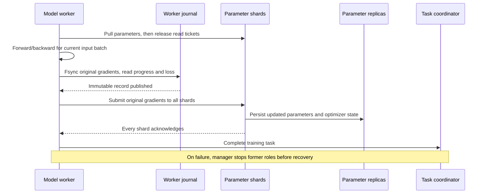

# Durable worker gradients and job recovery

Synchronous workers persist original gradients before sending them to parameter
shards. An explicit manager uses those journals and the parameter replicas to
resume the same model run after worker or coordinator processes fail. Recovery
preserves committed rounds, reconciles a partially committed round and restarts
workers at the matching input positions.



## Worker storage

Enable the journal in the TensorFlow model worker configuration:

```json
{
  "journal_directory": "/srv/training/journals/worker-0",
  "journal_workers": 2,
  "journal_base_round": 0
}
```

Each directory has one process-lifetime advisory lock. Its identity binds run,
partition epoch, worker/group, shard count, table configuration, model shape,
input sequence and initial journal round. Restart configuration must match that
identity. The input sequence is the existing deterministic cyclic JSON reader;
its SHA-256 and next-batch position are checked on continuation.

A round record contains ordered uint64 Keys, exact FP32 sparse gradients, sample
count, loss and the completed transport read frontier. Binary files preserve
large IDs and float bits without pickle. SHA-256 covers metadata and payload.
Publication fsyncs a temporary file, links an immutable round filename and fsyncs
the directory before submission. Duplicate identical publication succeeds;
changed data, missing rounds, non-finite gradients and corrupt files reject.

The default record limit is 32 MiB, including metadata, while gradient data also
obeys the native submission limit of 16 MiB. The default directory budget is
1 GiB. Exhaustion fails before another gradient is sent. History is retained for
recovery and exact loss comparison; compaction is subsequent work. The original
non-journal worker path remains available.

## Recovering an interrupted job

The manager first terminates all former workers **and their native-client child
processes**, primaries and coordinator. Replica processes and worker storage
remain accessible. It advances each replica's primary term and starts fresh
parameter primaries with `recover: true` at their selected service endpoints.
Fresh primaries restore parameters/Adam state and discard abandoned read tickets.

The recovery configuration contains:

- `run`, `epoch`, `end_round` and `coordinator_endpoint`.
- `workers`: the complete original model worker configurations, including
  journal directories and `journal_workers`.
- `shards`: ordered objects with `endpoint` and `config`; `config` is that
  shard's replacement primary configuration, including its new granted term.

Use the Python interpreter associated with the native client module:

```sh
python scripts/recover_training.py --config job.json --build build/tensorflow \
  --action plan --out recovery-plan.json
```

The planner locks every journal and validates the group against the replica
configuration. In sequential synchronous training, shard frontiers can differ
by at most one. The largest frontier selects the recovered coordinator round:

| Durable shard state | Recovery action |
| --- | --- |
| All shards at round `r` | Restart at `r`; reuse an existing worker gradient for `r`, or compute it from unchanged parameters |
| Some shards at `r`, others at `r+1` | Require every original worker gradient for `r`; replay it to all shards before model work resumes |
| All shards at `r+1`, task completion was lost | Reconstruct completed worker clocks at `r+1`, then continue with its next batch |

The planner emits a paused coordinator configuration in `coordinator` and
worker restart configurations in `workers`. Start the replacement coordinator
using that configuration and the chosen `coordinator_endpoint`. The startup-only
`replica_next_round` operation accepts a fresh sequential controller, preserves
the run identity and leaves admission paused. This is separate from fresh-run
checkpoint restore.

```sh
python scripts/recover_training.py --config job.json --build build/tensorflow \
  --action reconcile --out recovery-ready.json
```

Reconciliation verifies the paused coordinator and quiescent replacement shards.
For a partially committed round it submits the journaled original gradients;
completed shards acknowledge without reapplying, and lagging shards commit.
Repeated reconciliation at the resulting common round performs no extra update.
Changed input, missing required gradients, active journal writers and incompatible
frontiers fail before replay. Only after `ready: true` may the manager resume the
coordinator and launch the emitted worker configurations. If `complete: true`,
all requested rounds are already durable and no additional worker tasks are
needed.

Transport sequences are restored independently of training rounds. The planner
uses replica request frontiers and journaled read completion. A fresh adapter
accepts that initial read sequence once; it cannot reset an active stream.
Workers that already journaled the interrupted round reuse those exact gradients
and loss. Other workers compute the missing round from the common pre-update
parameters. New observations of later parameter values cannot replace an
original gradient during partial-commit reconciliation.

## Executed verification

The CPU model check runs two TensorFlow workers, two parameter shards and
independent replicas over a 64-row, 8-dimensional table. At round 3 of eight it
kills actual worker process groups, the coordinator and both primaries, then
promotes/restarts roles and executes the recovery tool.

The three faults cover a live Pull ticket, a shard-partial commit with lost
replies, and completed parameter updates before task completion. Recovery reaches
round 8 with every weight, both Adam moments, row update counter and worker
loss identical to uninterrupted training: maximum absolute differences are zero.
The live-read case explicitly reuses another worker's persisted round-3 gradient;
the partial-commit case rolls that round forward before opening admission.

Negative checks preserve durable frontiers while rejecting changed input, a requested
end before durable progress, a held journal lock, a missing partial-round
gradient and an unreconciled GPU-owner configuration. Repeated reconciliation
is checked before resumed training. Journal unit checks cover exact uint64/FP32
round trips, immutable retries, corruption, monotonic read progress and budgets.
The native adapter/controller checks also resume from read/task sequence 50,000.

```sh
ctest --test-dir build/tensorflow --output-on-failure \
  -R '^(durable_worker_gradients|tensorflow_worker_recovery)$'
```

The original check uses CPU parameter ownership and retained local/shared
journal storage. [Replica-backed owner recovery](REPLICA_OWNER_RECOVERY.md)
extends the tool to term-bound replacement owners, complete row/Adam rehydration
and resumed training; its two-owner Host process check passes. CUDA execution
awaits rental inventory. Multi-node journal retrieval,
node/storage loss, automatic process supervision and stochastic reader/RNG
integration require their own execution. The beyond-single-GPU capacity workload
and complete original Entropy integration remain part of project acceptance.

[Validation record](validation/2026-11-04-worker-recovery.json) ·
[Replicated parameter updates](REPLICATED_TRAINING.md) ·
[Joint checkpoints](JOINT_TRAINING_CHECKPOINT.md)
